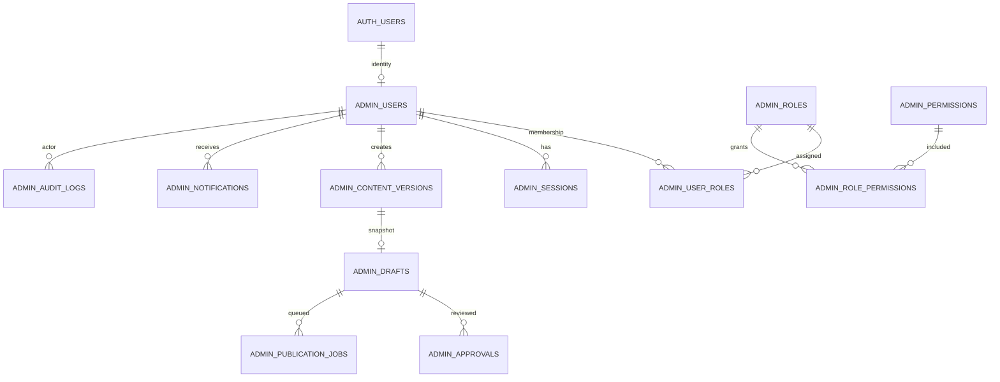

# Master Admin architecture

The owner has chosen the existing shared Supabase project `jvpadtzfsuekixrquzjv` only. See [current boundary and review](MASTER_ADMIN_SHARED_PROJECT.md), which supersedes the separate-project recommendation in the historical Phase 4 architecture. `/admin` is currently a Preview UI, not an authenticated application. The proposed private schema separates names and grants, **not** Auth, database, operational risk or backups from Production. A Preview connected to it can affect Production. Shared security migrations and real publication require exact review and explicit approval.

This diagram describes candidate tables only; target mapping, durable outbox, receipt, idempotency and a live session resolver and production-integrated verified identity are not implemented. No production publication connection exists.
