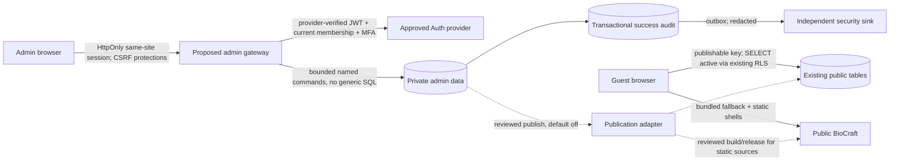
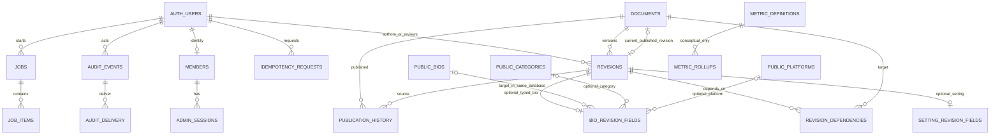

# BioCraft Master Admin — Phase 3 backend integration proposal

**Decision document, not authorization to deploy.** This stage changes only files in the Preview branch. No database migration, policy, content, Auth user, administrator, infrastructure, environment variable, public app or Production deployment was changed. The SQL is exact, executable **review-only draft SQL for a default-deny foundation**, not a complete working migration set. Critical operational SQL and real-stack tests remain open; do not apply any draft to the shared database or any other target without explicit approval of that exact target and migration set. See the [SQL manifest](MIGRATIONS.md).

## 1. Investigation: current architecture and evidence

| Area | Observed state / implication |
|---|---|
| Preview UI | `src/admin/backend.ts` is a fail-closed TypeScript contract. There is no live admin API, sign-in, membership or permission enforcement. The browser-only scratchpad is ephemeral and not a draft store. Preview/noindex are not security. |
| Guest access | `src/lib/supabase.ts` creates an optional, guest-only client; no session persistence/refresh. `BioCollectionPage.tsx` reads active `bios` by `source_slug`, otherwise falls back to bundled collections. An empty successful remote set is authoritative, but a failed fetch falls back to the bundled set. |
| Guest data | Read-only catalog inspection of shared project `jvpadtzfsuekixrquzjv`: 10 public tables (`bios`, `categories`, `platforms`, `generators`, `fonts`, `symbols`, `emoji_collections`, `hashtags`, `captions`, `seo_pages`), all RLS-enabled, owner `postgres`, FORCE RLS off. Each has an `anon,authenticated` active-row SELECT policy. Direct grants query found no INSERT/UPDATE/DELETE/TRUNCATE grants for those roles, but **did find SELECT, REFERENCES and TRIGGER grants**. This is not a complete effective-privilege or security audit; inherited roles, schema privileges, executable functions, ownership, bypass paths, and potential trigger creation require independent review. Do not change grants without approval. RLS does not govern REFERENCES/TRIGGER/TRUNCATE or bypass roles. |
| Functions | `public.search_bios` is SECURITY INVOKER, owner `postgres`, with stable tie-breaker `id` following flags/time, but uses offset pagination; guest access still relies on caller permissions/RLS. `fetchCollectionBios` makes multiple keyset requests with an exact-count consistency check; same-count changes/reordering can still evade detection. Neither is an admin interface. |
| Deployment history | Connector returned four applied migrations `0001_initial_schema`, `0003_reconcile_live_to_repo`, `0002_rls_policies`, `0004_stable_bio_pagination` (provider order). The previous `0004` was applied without the requested approval and was disclosed; this stage did not modify or reverse it. No Edge Functions or DB branches were listed. Empty branch list does not establish entitlement to branching. |
| Sources of truth | Public collections and initial bios are bundled in `src/lib/bioCollections.ts`; generator categories in `src/tools/bio/data/categories.ts`; platform config in `src/tools/platforms.ts`; tool metadata/routes in `src/tools/registry.ts`; static SEO shells in `scripts/build-shells.mjs`. Existing `public.categories`, `platforms`, `generators` and `seo_pages` are **not automatically the source for those public consumers**. There is no public collection table. The existing `bios.character_count` is DB-generated with `char_length`; platform-specific counting may differ. |
| Caveat | Metadata queries are point-in-time. No secrets or Auth configuration were fetched. The observations do not prove hosted guest behavior, concurrent consistency, vulnerability absence, backup entitlement or a full grant inventory. |

**Important publication blocker:** a bio archived or deleted in the database can reappear from an older bundle if the remote request fails. No permanent removal guarantee is possible until the owner approves and engineers implement a fail-safe public release/fallback/tombstone strategy across old deployments, CDN caches and offline clients. A successful DB transaction alone does not update bundled categories, platform configuration, generator logic or static SEO. Do not promise complete public propagation or recovery from database writes alone.

## 2. Isolation decision: no new project is inherently required, but a Preview backend must not share Production state

| Option | Isolation and implications | Decision |
|---|---|---|
| A. Private schema + server in the **existing shared DB** | Smallest infrastructure footprint, same-database atomic publication, existing Auth. But any DDL, Auth, RPC or publish affects the Production-connected project even from Preview. DB owner/service-role privileges and operational faults affect guests. Server isolation alone does not isolate the database. | Potential future Production topology **only after explicit approval and independent review**. Forbidden for current work and not an isolated Preview. |
| B. A branch of the **existing Supabase project** + Preview-only gateway | Potential isolated DB/Auth environment while preserving project continuity, subject to actual entitlement, branch creation consent, data/secrets isolation and an independently confirmed provider behavior. Schema/seed synchronization and absent Auth users must be handled; real Production data is not needed for tests. | Preferred integration test path *if supported and explicitly approved*. No branch was created; do not bypass plan restrictions or upgrade. |
| C. Local Supabase-compatible stack with synthetic data, or an independently provisioned ephemeral Postgres/Auth emulator | No shared mutations; good for schema, transaction and contract work. Local mocks do not prove hosted provider JWT, RLS, PostgREST, MFA, storage, concurrency or Edge behavior. Non-Supabase PostgreSQL needs an explicitly reviewed identity/RLS adapter. | Safest next engineering step once local implementation is authorized. A local fixture is not a hosted integration environment. |
| D. Separate Supabase project | Stronger credential, quota and operational separation; new project means duplicated infrastructure and possible cost/data synchronization. It does not magically authorize publishing to existing Production data. | Not necessary for all designs; could be recommended for hard production isolation, but **no project may be created without explicit approval**. |
| E. External admin service + separate administrative data store | Stronger admin-data boundary; introduces separate Auth trust and cross-database release, independent backup, consistency, availability, worker credentials and cost. | Viable with approval; requires an explicit secure publication bridge. No cross-database transaction can atomically commit both stores. |

Recommended: continue with local fixtures and review. If authorized and entitled, run full-stack tests in an isolated branch of the existing project using synthetic accounts/data. Select a future Production topology explicitly; do not assume Preview branch isolation protects the shared database. Option A has stronger transaction simplicity but weaker blast-radius isolation; option E needs an outbox/idempotent bridge. No option is provisioned by this proposal.

## 3. Trust boundaries and relationships

Dashed arrows are **not implemented**. For an isolated administrative DB and separate public DB, the publisher must be explicitly designed across trust boundaries; never give an untrusted browser a privileged project credential. At the same DB target, transactions can commit public changes and audit together. Across DBs use an authenticated, idempotent outbox/receiver in the target DB, transactional target-side audit and acknowledgment, reconciliation, retry, duplicate detection and conflict handling; an external sink cannot be atomically committed with the source DB. Neither path is approved or deployed. A default-off switch and independent release approval remain necessary. Source/target version identity must include environment; never reuse a Preview public ID as a Production ID without an explicit mapping.

**Conceptual-only** metric relationship is not a SQL foreign key in this draft. Other entities—collection, platform, generator, category, SEO and setting—are represented as typed `documents`/`revisions` plus future validated adapters, not generic arbitrary public-table writes. Proposed bio foreign keys in `003` work only when admin and public target objects exist in the **same** database; the cross-database option needs a distinct target mapping design. Auth user references mean identity removal is restricted to preserve audit/revision provenance; retention/privacy and account erasure policy need approval.

## 4. Auth, MFA and roles

Proposed model: staff-only invitation/enrollment out of band, only after approved bootstrap; ordinary public authenticated users are not admins. A separately reviewed gateway validates provider JWT signature, issuer, audience, expiration, `sub`, session binding and assurance; it then checks enabled membership, permission and any resource scope in the target transaction. For a browser, prefer server-managed Secure/HttpOnly/SameSite cookies with CSRF token plus origin validation; final provider-compatible BFF architecture requires XSS/CSRF review. Never place tokens in URLs, client logs or audit. A fresh provider-verified MFA/step-up timestamp is required for high-risk operations; `aal2` alone does not prove recency. `admin_sessions` is a proposed supplemental deny/revocation registry, **not proof of session or MFA**. Validate provider session IDs, refresh rotation, revocation and logout semantics against the real provider before adopting it. Rate-limit login/recovery, protect enrollment and recovery, rotate secrets and monitor suspicious events.

### Proposed permissions (S super admin, A admin, E editor, M moderator, R analyst)

| Named permission | S | A | E | M | R | Additional rule |
|---|:---:|:---:|:---:|:---:|:---:|---|
| `dashboard.read` | ✓ | ✓ | ✓ | ✓ | ✓ | scoped/redacted; unavailable is not zero |
| `users.read`, `users.moderate` | ✓ | ✓ | — | ✓ | — | privacy/scope rules and provider session semantics still needed |
| `members.manage` | ✓ | — | — | — | — | recent MFA, serialized final-S invariant, separate approval/bootstrap |
| `bios.read`, `content.read` | ✓ | ✓ | ✓ | ✓ | — | M scoped to review/moderation |
| `content.draft` | ✓ | ✓ | ✓ | — | — | kind + ownership scope |
| `content.review.reject` | ✓ | ✓ | — | ✓ | — | not own revision |
| `content.review.approve` | ✓ | ✓ | — | — | — | independent reviewer, not own revision |
| `content.publish` | ✓ | ✓ | — | — | — | reviewed version, fresh MFA, kill switch, concurrency + approval |
| `analytics.read`, `analytics.export` | ✓ | ✓ | — | — | ✓ | approved aggregates and small-cell suppression |
| `audit.read` | ✓ | — | — | — | — | redaction, access monitoring |
| `system.read` | ✓ | ✓ | — | — | — | no infrastructure secrets |
| `system.manage` | ✓ | — | — | — | — | explicit provider/operation approval and step-up |

This matrix matches the existing review helper's coarse allowlist; **scope, independent review, MFA recency, last-S, field-level rules and transactional workflows are not implemented by that helper**. Analyst is retained for continuity with earlier requirements; remove or defer only on owner decision. Default deny unknown operations. Permissions in UI are hints; server and database are authoritative. Last-super-admin demotion/disable requires serializable/global-lock protection and two-person approval/recovery path, never a simple pre-check.

## 5. Domain model and invariants

- `documents` represents a named management object (bio/category/collection/platform/generator/library/page/SEO/site setting/feature flag); `revisions` carry immutable **submitted** payloads, hashes and version/base pointers; only a draft can be edited. Draft SQL 004 proposes basic revision/sidecar immutability and allowed transitions, but not complete workflow invariants or authorization. `publication_history` links prior/current revision and actor; audit successful changes in the same transaction as local state and publication.
- Draft → submitted → approved/rejected; rejection requires a reason. Submit freezes content; review by a different principal; only S/A independently approve. Publish only approved content with current-base compare-and-set, current role, recent step-up and switch on. New draft after rejection; rollback creates a new draft of an older revision and follows the same process, never blindly overwrites current public state. Two simultaneous publishes: lock document/target, check version, one succeeds and other returns 409. Record request UUID, actor, target, operation and redacted before/after hashes; never store tokens or raw PII in audit.
- CRUD is persistent revisioned create/read/update and reviewed archive/unpublish. The owner asked for permanent CRUD: hard delete must be a separately specified, approved retention/legal action after backup/recovery and dependent-FK review; due to `RESTRICT` links it is not covered by the current drafts. For emergency takedown define separately authorized stop procedure; no implicit bypass of review.
- Bios need kind-specific validation for `content`, `plain_content`, style, language, title, derived flags and generated count. Validate all eight app configurations independently; distinguish LinkedIn headline 220 and About 2600 and explicitly settle code-point/UTF-16/grapheme counting and null platform behavior. `char_length` is not automatically a platform-valid measurement. Never set generated `character_count`. Preserve public `source_slug`, uniqueness and guest-read shape; migrate or backfill only with a reviewed mapping and backup.
- Category/collection mapping must resolve IDs, public route slugs and generator categories separately; they currently are not equivalent data models. Platform/tool config requires per-tool language/preset schemas and validation; no universal platform limit. SEO must validate URL/redirect/canonical/robots and text escaping, then regenerate or rework static shells via an approved deployment flow. Admin settings are revisioned, typed, allowlisted; no secret values in DB payload or UI. No unsupported translation/AI behavior is implied.
- `idempotency_requests` reserves actor + operation + key + canonical request digest; a future function atomically rejects same key with different body and saves successful result with audit. Its DDL alone does not implement replay/concurrent reservations or safe expiry. Bulk drafts max 100 with validation and per-item audit/results; no bulk direct publishing. Jobs need durable leases, cancellation, retries, tenant-bound downloads and retention, not yet designed as executable workers.

## 6. API and Edge Function specification

The normative endpoint detail is [`../master-admin-blueprint/API_CONTRACTS.md`](../master-admin-blueprint/API_CONTRACTS.md); it is a proposed contract, not code. Proposed `/api/admin/v1` handler may be a Preview-only server or a Supabase Edge Function **inside the explicitly isolated target**. Do not assume Vercel Preview means an Edge Function accesses an isolated DB.

| Handler group | Representative routes | Gate / operation | Dependencies |
|---|---|---|---|
| Session | `GET /me`, `POST /session/logout`; provider MFA challenge/verify | verified session + membership; no browser-supplied role | provider flows, secure cookie/CSRF, correct revocation |
| Members/users | `GET /users`, `GET /users/:id`, `POST /users/:id/status`, `POST /members/:id/role` | `users.read`/`users.moderate`/`members.manage`; scope and step-up | actual staff vs public-user product decision; last-S locks; Auth provider API |
| Content | `GET /bios`, `POST /documents`, `PUT /documents/:id/revisions/:id`, submit/review/publish/rollback-drafts | per-kind named permissions, If-Match, independent review, MFA, idempotency, switch | typed validators, transactional audit and mapping, target-specific adapter |
| Resources | lists for `/categories`, `/collections`, `/platforms`, `/generators`, `/pages`, `/settings` | `content.read` or `system.read`; mutations via revision workflow | complete typed schemas and public consumer/release design |
| Audit | `GET /audit` | `audit.read`, privacy-scoped and audited access | protected storage, external delivery and retention |
| Reporting | `GET /analytics`, `POST /reports` | approved data only, `analytics.read/export`, ranges/thresholds | consent, real telemetry/rollups, secure async export |
| Operations | `GET /system/health`, `POST /system/backup-request`, cache invalidation | `system.read/manage`, explicit step-up | actual provider APIs, recovery runbooks and least privilege |

JSON-only, bounded body, strict schema/unknown-field rejection, UUID/idempotency key; 401 invalid identity, 403 no permission, 400/422 invalid input, 404 masked where necessary, 409 stale base/key mismatch, 429 throttled, 503 unavailable. Return safe correlation IDs and `Cache-Control: no-store`; no stack traces, tokens, SQL or PII. Cursor lists: `limit` bounded 1–100, validated filter/sort allowlists and opaque/signed cursor tied to actor/scope/query and stable unique tie-breaker. A cursor or `as_of` is not a snapshot: choose actual snapshot/materialized export strategy for multi-page reports. Abort obsolete searches and avoid unnecessary requests; load-test indices and plan with `EXPLAIN` on synthetic isolated data.

Gateway may call only narrowly scoped database RPCs; each RPC rechecks verified identity/current membership within the transaction. Direct PostgREST/RPC invocation must not grant more than gateway; absence of schema exposure and JWT-only middleware are not enough. Use hardened search paths and fully qualified names, carefully reviewed owner privileges, transaction-local context provided by a verified gateway, and no arbitrary user-settable impersonation. No user-facing service-role key; if an external publisher absolutely needs elevated access, use a uniquely scoped server credential, strong workload identity where supported, network restrictions, dual controls and independent review. A service-role bypasses RLS; **do not** rely on RLS to constrain it.

## 7. RLS and SQL status

`001`, `002`, `003` and `004` are exact draft SQL; `098` is a non-destructive emergency-stop proposal. The private-schema draft grants no browser access and applies restrictive deny policies to all 16 private tables. Existing public guest policies are not modified. The draft `require_permission` uses `auth.uid()`/`auth.jwt()` with AAL2 and a membership row lock, but is not a complete auth system, has no direct client EXECUTE grant, does not check recent MFA, and does not constrain a bypass-capable owner. Security-definer role ownership, row locking/deadlocks, role membership, default privileges and exposed schemas must be finalized on the actual approved platform. Existing denied-client policies are intentional; the target pattern is permission-checked narrow server RPCs, not direct table grants. Exact future RPC grants and policies must be produced and reviewed after those functions/roles are designed.

**Missing exact migration SQL:** privileged owner/service roles and default privileges; operational RPCs/grants; full workflow authorization, immutable audit semantics and type validation; bootstrap/recovery and final-S invariant; actual publish/public-consumer adapters; external security event delivery; session-provider integration; jobs/leases/export storage; telemetry ingestion, suppression/retention; precise indexes after query plans; and target-specific rollback. Thus this is not the complete executable migration set requested for a live system. Exact implementation cannot safely be represented as ready without the unresolved isolation, identity and release decisions and actual target review; see [MIGRATIONS.md](MIGRATIONS.md). No unsafe placeholder SQL is offered as a working backend.

## 8. Threat analysis

| Threat | Proposed countermeasure | Residual/validation |
|---|---|---|
| Compromised admin or stolen session | provider MFA, fresh step-up for roles/publish, short session, revocation and alerts, least privilege | MFA recovery and JWT invalidation provider-specific; test real devices/tokens |
| Guest/ordinary user escalates | explicit current server membership, deny by default, DB guard, no client role trust | direct PostgREST/RPC and service-role bypass tests mandatory |
| XSS/CSRF/token leakage | CSP, output encoding, HttpOnly cookies, CSRF + origin checks, no tokens in URLs/logs | CSP and third-party dependencies independently reviewed; browser memory/XSS still risk |
| Definer escalation / SQL injection | narrow typed RPCs, fixed search path, safe SQL, owner/grants audit | owner/superuser and BYPASSRLS exempt; actual grant/effective-role inventory needed |
| Malicious insider / compromised S | two-person review, last-S protection, step-up, independent event sink and kill switch | privileged DBA can alter DB audit/controls; independent monitoring and procedures required |
| Stale publish, replay, partial cross-system release | version checks, locks, atomic same-DB audit, idempotency, target-side audit/outbox | exactly-once is not assumed; reconcile failures, no distributed atomic transaction |
| Published content or SEO injection | per-kind validated schema, no arbitrary HTML/scripts, review, escape, safe URLs | static shell rebuild and cache propagation need real tests |
| Resurrected withdrawn content | approved versioned fallback/tombstone strategy and CDN/old-client handling | current fallback can resurface old bundle on outage; blocker for reliable takedown |
| Analytics reidentification/export abuse | consent/legitimate-basis review, allowlisted aggregate metrics, thresholds, bounded ranges, scoped short-lived downloads | source/provider/privacy policy not selected; unavailable until approved |
| Audit tampering or backup loss | transactional audit, out-of-band immutable retention, encryption, restore drills | DB-owner can bypass local guards; provider backup entitlement and restore correctness unverified |
| DoS and expensive queries | bounded body, filters, rate limits, cursor pages, cancellation, worker quotas | load/EXPLAIN testing in isolated stack; no latency guarantee |

## 9. Backup, incident response and rollback

1. Before any approved migration/feature, verify actual provider backup, retention and restore entitlements, record baseline schema/migration/grants/policies, content checksum/export scope and RPO/RTO; choose encrypted, access-controlled storage and an independent audit sink. Never print secrets. **No backup was created or restore verified in this phase.**
2. Practice restore into an explicitly approved isolated environment using synthetic fixtures first; verify guest reads, counts/checksums, RLS, functions, versions and audit continuity. Exercise recovery of Auth/session and release assets separately: a DB backup alone may not capture Auth provider keys/config, object storage, Edge secrets, Vercel deployments, Git source or cached static pages. Observe provider consistency and dependency order.
3. Emergency: stop gateway traffic, set publish/telemetry off in the approved target (review-only SQL shows the data-level stop), disable affected credentials and rotate via provider according to a separately authorized incident process, preserve forensic evidence. In-flight transactions, cached responses and already issued JWTs may persist; a switch alone is not immediate revocation.
4. Roll back code by routing to known safe Preview/deployment, preserving schema and evidence. Roll back published content as a new reviewed compensating revision; handle DB/bundle/SEO/CDN versions together. Cross-DB releases require per-target receipts and reconciliation. Do not blindly restore shared Production over newer data.
5. Existing `099-schema-removal.REVIEW.sql` erases audit and no longer covers new dependencies; it is **not a valid rollback for this combined draft**. Removal requires a new ordered, tested, no-CASCADE plan plus explicit owner approval and evidence-retention decision. Default response is disable without dropping data.

## 10. Verification plan and gates

Detailed matrix: [`../master-admin-blueprint/TEST_PLAN.md`](../master-admin-blueprint/TEST_PLAN.md). This stage ran only local PGlite `test:admin-phase3-schema`, `test:admin-blueprint` and TypeScript: validates draft DDL parsing, restrictive policies, representative grant denials and guest fixture, constraints, representative revision transitions, role examples and disabled switches. It does **not** validate provider Auth, signature verification, MFA, effective PostgREST grants, direct bypass, real HTTP, concurrent isolation, recovery, production schema parity or actual audit immutability.

Release gates after explicit isolated-environment approval:
1. Compare schema, owners, default privileges, effective grants including REFERENCES/TRIGGER, RLS/policies and callable functions against a reviewed baseline; fail on drift. Seed synthetic fixture only, run migrations in a transaction and test clean reinstall/rollback on disposable instances.
2. Real provider Auth tests: anonymous, nonmember, all roles, disabled member, AAL1/AAL2, no recent step-up, expired/forged/wrong-issuer token, session theft/revocation, recovery and concurrent final-S demotions; test direct REST/RPC, definer search path, ownership and lack of client write privileges.
3. Workflow tests: edit/submit immutability, self-review denial, all roles/kinds/languages/eight platforms, generated fields and length validation, stale `If-Match`, concurrent publish, idempotency mismatch/retry, invalid dependencies, kill switch, transaction/audit rollback, bulk per-item failure, archive/delete and rollback-as-new-draft.
4. Guest invariants: RLS active-only, unchanged anonymous and authenticated guest reads, collection pagination under ties/concurrency, no draft leak, known offline fallback/tombstone behavior, full tool/config/SEO build/release and cache behavior. Test exact approved target only; never mutate shared project as a fixture.
5. Real telemetry/export privacy, security sink failure and retry, provider health errors; backup/restore drill and incident runbook; load, browser/network, keyboard/screen reader, real Android + field vitals and independent security review. Collect evidence, then request distinct owner approvals for onboarding, migration, publication and Production.

## 11. Sequencing, estimates and decisions

Estimates are rough engineer-days for one experienced engineer with part-time security review, exclude owner approvals, provider/plan delays and unknown integration scope. Ranges overlap; not a delivery promise.

| Phase | Dependency / output | Estimate |
|---|---|---:|
| 0. Architecture decisions | Isolation, identity/provider, scope, policy, data inventory, RPO/RTO and privacy | 3–7 days + approval |
| 1. Exact reviewed migrations + local service | Complete SQL ownership/RPCs, disposable real-Postgres tests, typed contracts, role/session invariants | 10–20 days + independent review |
| 2. Isolated real Auth and API | Approved branch/target, MFA, bootstrap rehearsal, audit/monitoring, direct-bypass tests | 10–20 days |
| 3. Bio workflow and release | Typed CRUD/review/rollback, safe publication, bulk, tombstones/fallback and guest tests | 15–30 days |
| 4. Remaining configuration and user modules | Auth provider user scope, categories/collections, platform/generator/settings, SEO consumers and release | 20–40 days |
| 5. Analytics and operations | Approved telemetry, real reporting/export, security sink, backups and restore exercise | 15–30 days |
| 6. Acceptance and security | Real device, accessibility, load, threat testing, independent assessment, owner Preview approval | 10–20 days |

Required decisions before implementation: (a) exact isolation choice and authorized target, (b) staff-only versus public account management and moderator scope, (c) first-S bootstrap and recovery/second-person policy, (d) whether a Preview publisher may ever access real public data (recommend no), (e) actual public source-of-truth/release/tombstone/SEO strategy, (f) analytics/consent/retention/export policy, (g) hard-delete/legal retention rules, (h) provider MFA/backup capabilities and costs. All remain open. **Wait for explicit owner approval before any shared database, security policy or Production change.**
