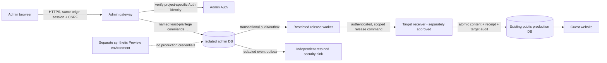

# Architecture and delivery specification

## Context and topology

Every arrow after the UI is proposed, not deployed. Preview has separate project/auth/DB, secrets, gateway, worker, issuer/audience and target, synthetic users/data, no production receiver route, no production signing capability, and a release-time allowlist plus negative tests. Do not clone production data. Separate projects reduce accidental administrative blast radius but a shared organization, operators, billing and provider still create correlated failures; use separate operator permissions and protect provider console/CI. Existing production Supabase and deployed website are not a test fixture. A separate gateway connected to the existing database alone is not DB isolation.

### Options

| Candidate | Boundary / Auth and integration | Recovery, costs and verdict |
|---|---|---|
| Separate Supabase project (recommended) | Separate DB/Auth/credentials/configuration; narrowly authenticated target receiver still requires a separately approved shared-DB change. No cross-DB ACID. | Managed services simplify Auth/ops; independent backups/restore required per project; per-project compute/storage and optional backup charges. Good practical compromise; no provisioning approved. |
| Supabase branch | Provider documents separate instances/API credentials; preview/persistent branches copy configuration and can deploy functions, and may merge changes to base. Entitlement, non-data/secrets isolation and exact behavior must be verified. Auth users/data not assumed copied. | Useful optional synthetic integration staging only, never production admin isolation. Branch lifecycle, accidental merge and cost need controls. |
| Independent backend service + independent database | Strongest choice for provider separation if independently operated; own Auth/trust, connectivity, key rotation, patching, backups, monitoring and receiver still needed. | More operational burden/cost and bespoke security; possible future choice when provider risk justifies it. |
| Same shared project/schema | Easiest transaction and fewest services; admin owner/definers and changes share guest blast radius; Preview can affect production. | Rejected for admin control plane. |

Provider references: [branch architecture/configuration](https://supabase.com/docs/guides/deployment/branching), [branch billing](https://supabase.com/docs/guides/platform/manage-your-usage/branching), [billing FAQ](https://supabase.com/docs/guides/platform/billing-faq), [PITR](https://supabase.com/docs/guides/platform/manage-your-usage/point-in-time-recovery). These are public documentation, not proof of account entitlement. Pricing is time/plan dependent: paid-org additional Micro compute is documented as roughly $10/month before usage, and documented 7-day PITR approximately $100/month per enabled project; branch compute, storage, egress, Auth, logging, gateway, testing, restores and taxes can add costs. No plan, number of projects, spend cap coverage, or actual quote was verified. Obtain a written provider estimate before provisioning; a branch is not necessarily free and PITR may be outside spend cap.

## Source of truth and v1 feature scope

Admin data is authoritative for staff membership, drafts, approvals and release intentions; public database is authoritative for guest runtime bio records after receiver commit. Store target-qualified stable resource IDs, never cross-database foreign keys; a signed environment binding and mapping prevent Preview IDs/commands from reaching Production. Avoid copying production user/content data into Preview. Initial import into production admin requires its own consent, provenance, checksum, and conflict handling.

* Bios: typed create/edit/archive as revisions. Validate allowlisted keys, canonical Unicode policy, locale en/hi/hg, text byte and provider/platform character semantics (including emoji and combining characters); derive `plain_content`, generated count and flags server-side; do not accept generated `character_count`. Associations map to target-verified stable IDs. Reject unsupported platforms/rules rather than guessing. Use base version/hash and idempotency; no hard deletion in v1.
* Categories/collections: draft logical objects and dependencies with stable keys, unique slugs, language/platform compatibility, referential and cycle checks, graph snapshot at submission. Existing collection lists, tool categories, platform registry and SEO shells are static; there is no live collection table. Do not claim DB publication updates them. v1 may model drafts only; public rollout requires a separately approved versioned site/build release adapter and tests. Unsupported kinds return 501/feature disabled, not synthetic success.
* Workflow: new immutable revision based on current release; draft -> submitted -> approved or rejected; approved -> release requested -> target committed -> reconciled/published -> superseded. Edits after submission create a new draft; author cannot review own work or publish it. S/A approve and publish; moderator can reject with reason. A rollback is a new revision, reviewed and published with same checks. Never mark published merely because outbox delivery began.
* Staff management only in v1: invitations are owner-controlled Auth workflow, disabled by default until gated, with enabled membership required; no public-user moderation without a real data source and a separate scope/privacy decision. Limit role edits to S, serialize final-enabled-S safeguard, no self-elevation; initial S bootstrapped through separately approved out-of-band two-person ceremony. Factor reset/account recovery require separate two-person audited provider procedure and invalidate local sessions. No shared project Auth account creation.
* Analytics is OFF until an approved real source, consent/legal retention, metric allowlist, aggregation, k-anonymity-like minimum cell threshold and complementary suppression, access and deletion policy are specified. Missing data is unavailable, never fabricated or zero. Review differencing attacks and export controls; threshold alone does not guarantee privacy.
* System configuration uses typed allowlisted non-secret settings through review and release. No arbitrary key/value, shell, SQL, provider settings, secrets, or no-review kill-switch enablement. Disable controls are independently actionable; enable requires separately authorized two-person change. Backup requests/exports are disabled until an adapter and retention policy exist.

## Public release protocol (normative; not implemented)

Target receiver is the only writer, uses a dedicated non-owner/non-BYPASS role with EXECUTE on a narrowly scoped, fixed-search-path target function, no generic table mutation capability to caller. Its protected owner gets only necessary table DML and audit/receipt access; verify provider support, exposed-schema restrictions and ownership/default privileges. Neither worker nor gateway uses target service-role credentials. If this cannot be achieved, publishing stays OFF. Strong workload authentication via environment-specific mTLS or an equivalent short-lived identity verified at target is required; HMAC with a stored secret is not a substitute for independently approved key lifecycle and endpoint protection. Audience, target environment, release ID, monotonically versioned resource base, request digest, expiry and replay key are bound to authenticated command. Limit operations/fields, rate, payload size and destination egress; disable endpoint and revoke identity independently.

1. In admin DB, lock revision, document and membership/session; verify named permission, separation of duties, fresh MFA, immutable canonical revision/hash, dependency snapshot, expected version and both safety switches. Atomically append audit plus outbox row with unique `release_id`, target environment, resource key, base target version/hash, canonical validated content, digest and actor/approver evidence; commit. No secret/token in row.
2. Worker leases a row with expiry and bounded retries; signs/authenticates transport with production-only identity, sends immutable command. A retry uses the same release ID and digest, never a new mutation. On uncertain responses query receiver status; no assumed success or cross-DB atomicity.
3. Receiver authenticates worker, pins environment/audience/expiry, validates schema/size/digest, verifies allowlisted operation, target switch and mappings, locks target resource and compares authoritative target base hash/version. One target transaction reserves unique release ID, rejects same ID/different digest, validates values/dependencies and target constraints, changes allowed content, writes target-side success audit/receipt with target version/hash, and commits. Concurrent different releases on same base: exactly one succeeds, others conflict; stale/no known base fails closed. An exact replay returns the stored receipt, not a second write. Denials logged outside the rolled-back transaction without sensitive payloads.
4. Worker verifies and persists receipt; admin transaction idempotently marks reconciled and appends local audit. Lost acknowledgments, source crash after target commit, timeout, and audit sink failure are recoverable by receiver status/replay; mismatches or missing/ambiguous receipts stop automated retries and alert. No external sink can be atomic with either DB; monitor outbox lag and reconcile target receipts vs source releases. Manual target mutations are detectable via base hashes/version and stop publication.
5. For content requiring static assets, include a versioned release manifest listing DB release, static source commit/build, target-specific IDs and cache/tombstone state. Verify real public consumers, CDN propagation, old bundles, rollback and no database/build version mismatch before declaring complete. Existing `BioCollectionPage` falls back to bundled rows on remote failure, so archive can resurrect: block withdrawal-dependent publishing until a separately approved fail-safe fallback/release strategy exists. Already cached/offline copies cannot be remotely guaranteed removed.

Atomicity above applies within each DB only. Full receiver schema/implementation, deployment identity and cryptographic details remain engineering work and require targeted approvals; illustrative design files are not deployable.

## Independently testable roadmap / approvals

| Gate | Location and output | Required approval and exit evidence |
|---|---|---|
| 0 Design (now) | Files + metadata-only review; no implementation | Owner accepts design and remaining limitations; no automatic downstream authority. |
| 1 Local | Disposable Postgres + mock Auth; implement migration candidates, gateway contracts and synthetic tests; no connected services. | Explicit authorization for local implementation; independent SQL review and test evidence; no claim of real Auth. |
| 2 Isolated integration | Separate synthetic project or supported isolated branch; separate gateway, keys, mock public target; real provider JWT/MFA/RLS and direct bypass testing. | Explicit creation/cost/target approval; owner manually provisions credentials in secret manager, never chat. No production data or credentials. Verify role capabilities, actual MFA freshness/session, backup/restore and negative env tests. |
| 3 Preview workflow | Connect Preview UI to isolated backend, real authorization and persistence, typed bios/category drafts, security/audit tests. | Explicit Preview deployment and synthetic accounts; no receiver to production. Guest regression, real browser/device checks and security signoff. |
| 4 Synthetic publication | Target receiver + outbox in separate synthetic public target; fault injection, release/build/cache and restore drills. | Explicit isolated migration and test data approval; prove no target production key reachable. |
| 5 Production readiness | Independent assessment, exact migrations/role owners, identity, restore evidence, RPO/RTO, fallback and privacy signoffs; production change plan and backup. | Distinct approvals for production admin project, credentials/bootstrap, shared target migrations/grants, Preview-to-production release integration, and deployment. Production publisher remains OFF until all gates pass. |
| 6 Pilot | Limited staff + bounded resource set; monitored canary and rehearsed containment | Separate explicit approval for each Production deployment, enablement and content publication. Never merge main or deploy implicitly. |
